# kindle-hub

**Turn a jailbroken Kindle into a morning newspaper and a desk dashboard.**
An AI-written brief arrives as an ebook every morning, and the screen rotates through
weather, air quality and markets during the day. It runs entirely on GitHub's free tier:
nothing to host, nothing to keep switched on at home.

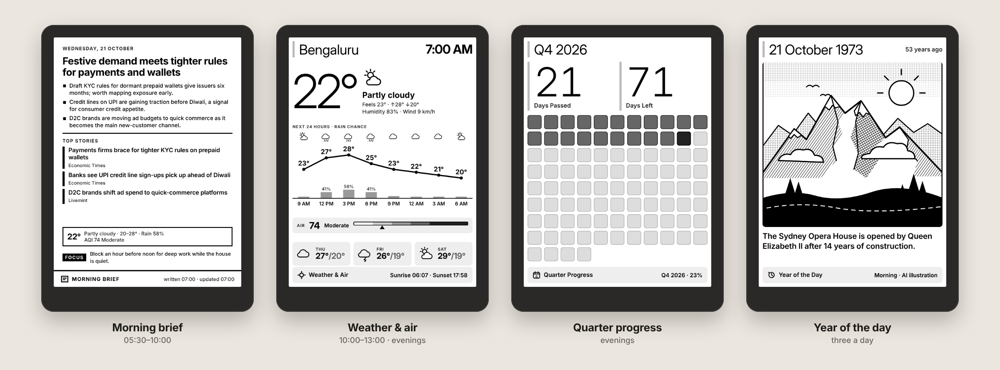

<sub>Screens shown with sample data (the Year of the Day picture is a hand-drawn stand-in for an AI one). They are rendered at the Kindle's exact resolution (600×800) in 16 shades of grey.</sub>

---

## What you get

- **A morning brief you read like a book.** At 05:47 IST, an AI model reads your news feeds,
  picks the stories that matter to you and writes a one-page summary with today's weather and
  markets. KOReader downloads it as an ebook with one tap. Through the day the brief is
  rewritten every 3 hours with the latest news.
- **A dashboard that changes through the day.** Leave the Kindle on a stand and it shows the
  brief in the morning, weather and air quality (with the time) at midday, markets while NSE
  is trading, the forecast and quarter progress in the evening, and a year from history
  overnight. It updates every 30 minutes, day and night.
- **₹0 to run.** GitHub Actions builds everything on a schedule and GitHub Pages hosts it. The
  AI uses OpenRouter's free models (about 10 calls a day). Weather and air quality come from
  Open-Meteo, which needs no key.
- **Screens you can add yourself.** Each screen is a small folder with a data script and a
  template. Copy one, change it, push, and it joins the rotation.

## The screens

<table>
<tr>
<td align="center" width="50%">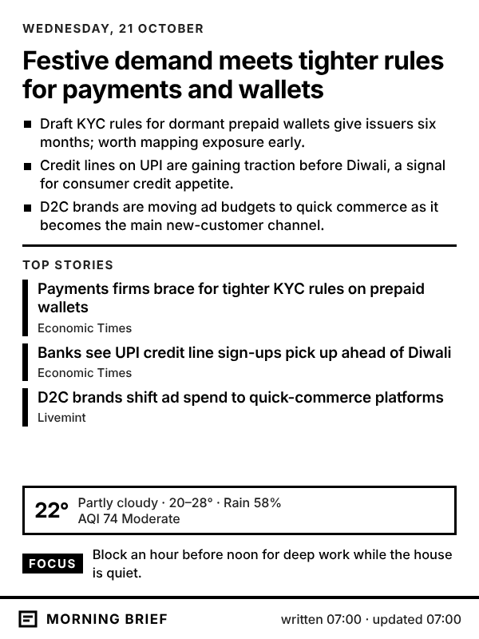<br><b>Morning brief</b><br><sub>05:30–10:00 and 13:00–14:00 · rewritten every 3 hours</sub></td>
<td align="center" width="50%">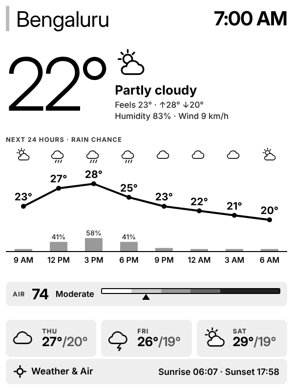<br><b>Weather &amp; air</b><br><sub>10:00–13:00 and 16:00–05:59</sub></td>
</tr>
<tr>
<td valign="top">AI headline, three takeaways, the top stories that fit on screen, a weather strip and one focus for the day.</td>
<td valign="top">The time and conditions now, the next 24 hours as a temperature line with rain-chance bars (every 3 hours, with a moon at night), air quality on the US AQI scale and the next 3 days, for Bengaluru. Refreshed every 30 minutes; on the Kindle Hub plugin the time is redrawn every minute.</td>
</tr>
<tr>
<td align="center">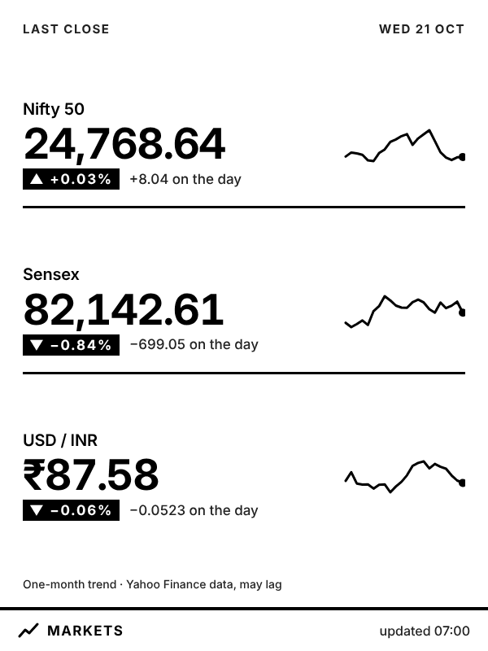<br><b>Markets</b><br><sub>09:15–15:30, Mon–Fri (trading hours only)</sub></td>
<td align="center">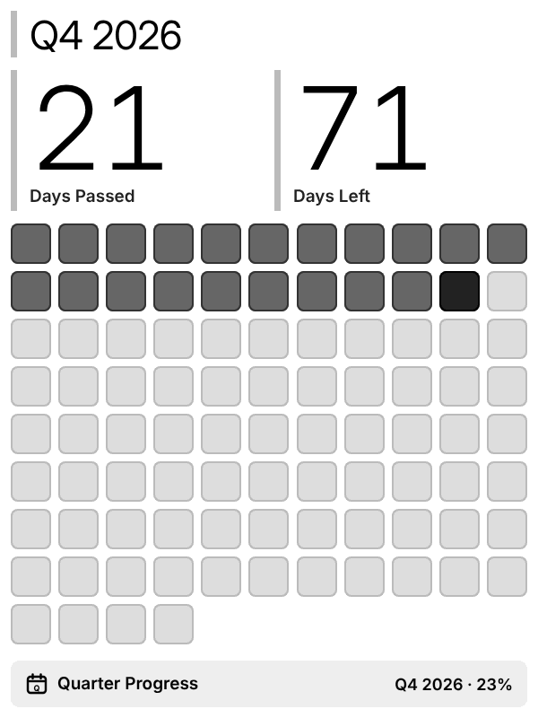<br><b>Quarter progress</b><br><sub>18:00–22:00, alternating with weather</sub></td>
</tr>
<tr>
<td valign="top">Nifty 50, Sensex and USD/INR with the day's move and a one-month trend line. Shown only while the market is open, never as a filler.</td>
<td valign="top">One square per day of the quarter (passed, today, still to come), with days passed and days left. Same clean look as TRMNL's <a href="https://trmnl.com/recipes/quarter-progress-212805">Quarter Progress</a> recipe, set out for a portrait screen. Switch to April–March financial-year quarters in its <code>plugin.yaml</code>.</td>
</tr>
<tr>
<td align="center">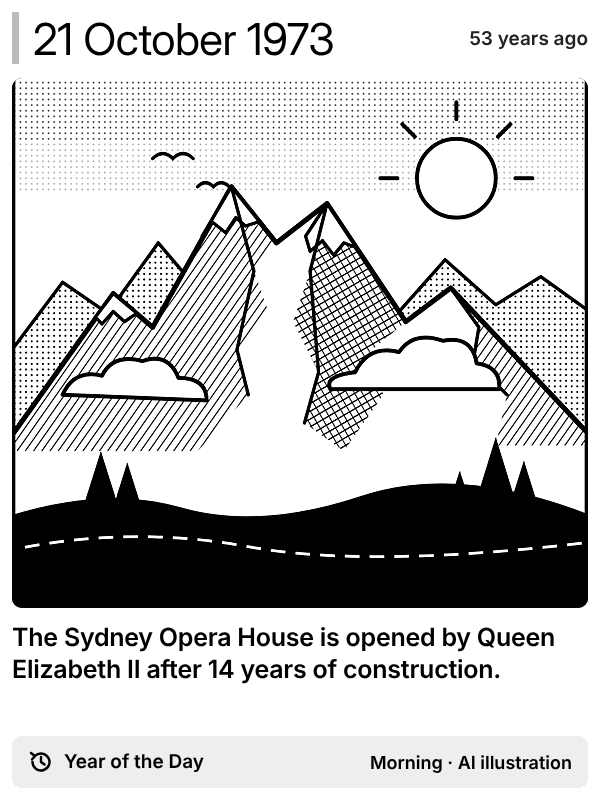<br><b>Year of the day</b><br><sub>three a day: on screen at 11:00, 17:00 and 23:00</sub></td>
<td align="center">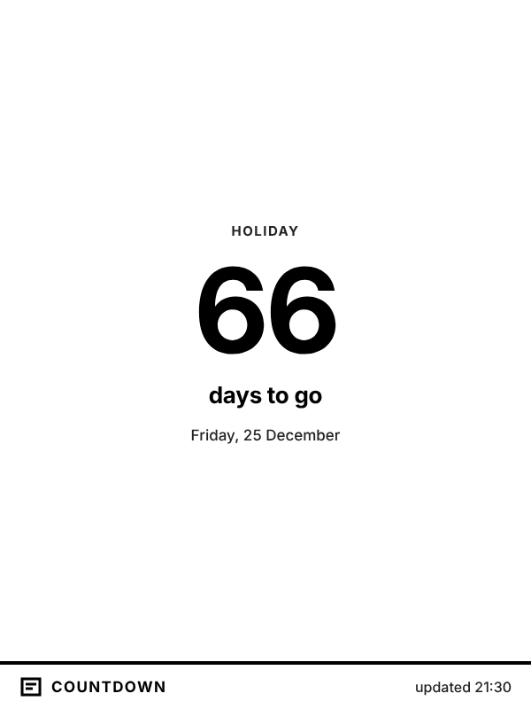<br><b>Your own screen</b><br><sub>a countdown, in three small files</sub></td>
</tr>
<tr>
<td valign="top">A year in history from Wikipedia's "On this day" events for today's date, drawn as an <b>AI comic panel</b> (or a vintage-newspaper illustration) with the headline, like TRMNL's <a href="https://trmnl.com/recipes/year-of-the-day-148248">Year of the Day</a> recipe. A new year comes in the morning, at noon and at 18:00, each with its own picture, made for free on Cloudflare. Without Cloudflare keys it shows the <a href="docs/images/screen-year_of_the_day-text.png">text version</a> instead. <sub>The picture above is a hand-drawn stand-in for the demo.</sub></td>
<td valign="top">Every screen is a folder you can copy. See <a href="#build-your-own-screen">Build your own screen</a>.</td>
</tr>
</table>

When two screens share a time window they take turns hour by hour. A screen whose data
couldn't be fetched is skipped, so the Kindle never shows an empty page.

## How it works

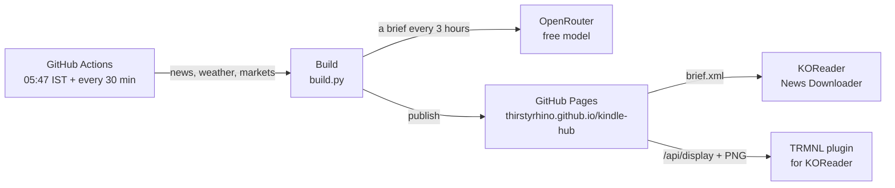

| When (IST) | What happens |
|---|---|
| **05:47** | Fetches feeds, weather and markets; the AI writes today's brief; screens are rendered and published. |
| **Every 30 minutes, round the clock** (:07 and :37) | Refreshes weather and markets and picks the screen for that hour. Reuses the brief until it's 3 hours old, then the AI writes a fresh one (08:37, 11:37, 14:37…); overnight, before 06:00, it keeps the last one. Year of the Day picks a new year at noon and 18:00. |

GitHub sometimes starts scheduled runs 10–30 minutes late. The screens are still never more
than about an hour old.

The site publishes four things:

| Address | Used by | Contains |
|---|---|---|
| `/brief.xml` | KOReader's **News Downloader** | The last 7 briefs as a feed; each becomes an ebook |
| `/api/display` | TRMNL's **KOReader plugin** | Which screen is on now, and its image |
| `/screens/current.png` | Any app that can show an image from a URL | The screen that's on now |
| `/` | You, in a browser | Every screen, plus the addresses to copy into the Kindle |

<p align="center">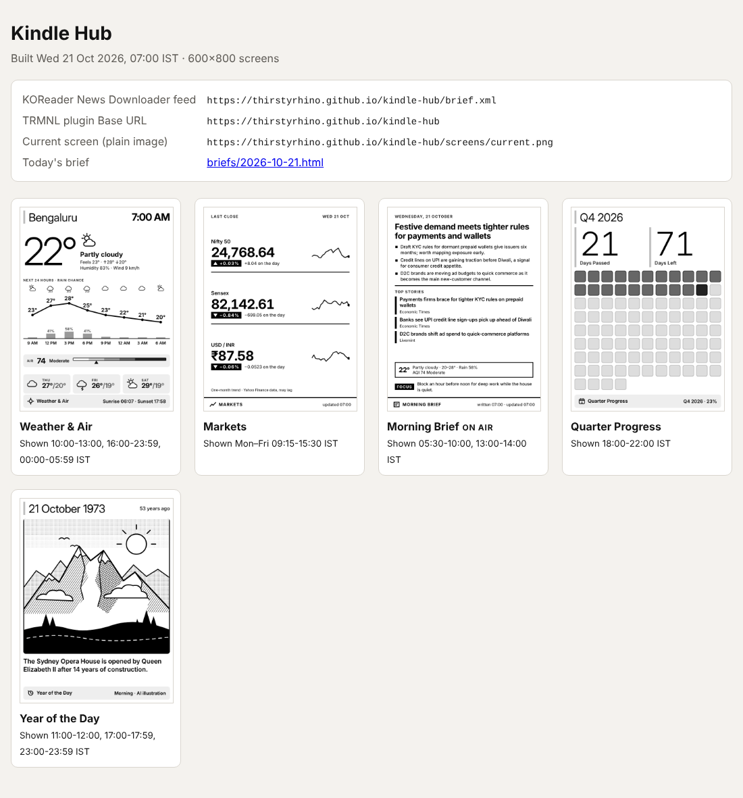</p>

---

## Set up

You need a Kindle that's already jailbroken with KOReader installed, and about 20 minutes.

### 1. GitHub (one time)

1. **Add your AI key.** Get a key at [openrouter.ai](https://openrouter.ai) → Keys. In this repo:
   **Settings → Secrets and variables → Actions → New repository secret**, name it
   `OPENROUTER_API_KEY` and paste the key.
   > No key? Everything still works. The brief becomes a plain list of top headlines.
2. **Turn on Pages.** **Settings → Pages → Build and deployment → Source: GitHub Actions.**
3. **Optional: AI pictures for Year of the Day.** Make a free [Cloudflare](https://dash.cloudflare.com/sign-up)
   account, open **AI → Workers AI → Use REST API**, copy the **Account ID**, then click
   **Create a Workers AI API Token** and copy the token. Add both as repository secrets:
   `CLOUDFLARE_ACCOUNT_ID` and `CLOUDFLARE_API_TOKEN`.
   > One picture a day uses under 1% of Cloudflare's free daily allowance. Skip this step and the
   > screen simply shows the text version.
4. **Run it once.** **Actions → Build Kindle site → Run workflow** (mode: `full`).
   When it turns green, open <https://thirstyrhino.github.io/kindle-hub/>.

Each run's page on GitHub starts with a short summary of what happened:

| Screen | Result |
|---|---|
| Weather & Air | rendered |
| Markets | rendered |
| Morning Brief (on air) | AI brief by `google/gemini-…:free` |

### 2. Kindle: the morning brief

1. In KOReader: **Tools → News downloader → Settings**, add a feed:
   - URL: `https://thirstyrhino.github.io/kindle-hub/brief.xml`
   - Limit: **1**
   - Download full article: **off** (the whole brief is already in the feed)
2. Each morning: **News downloader → Download news**. The brief appears in KOReader's news folder.

### 3. Kindle: the dashboard

1. Download [`trmnl.koplugin`](https://github.com/usetrmnl/trmnl-koreader) and copy the folder
   into `koreader/plugins/` over USB. Put any word in its `apikey.txt` (for example `kindle`).
   This site doesn't check it, but the plugin won't start without one.
2. Restart KOReader. **Tools → TRMNL Display → Configure TRMNL → Base URL:**
   `https://thirstyrhino.github.io/kindle-hub` (no trailing slash).
3. Stop the Kindle from sleeping: **Tools → More tools → Keep alive: on** and
   **Settings → Device → Auto suspend: off**.
4. **Tools → TRMNL Display → Start dashboard.**

Tap the screen to leave the dashboard and go back to reading. Start it again from the same menu.
Keep the Kindle on a charger while it's a dashboard. It checks for a new screen every 30 minutes.

### 4. Kindle: Kindle Hub, one tap away

The Kindle Hub plugin opens your Kindle Hub dashboard (Quarter Progress, unless you choose
another) as soon as KOReader starts, so you don't dig through menus.

1. Over USB, copy [`koreader/kindlehub.koplugin`](koreader/kindlehub.koplugin) into
   `koreader/plugins/`.
2. Copy [`koreader/kual-kindlehub`](koreader/kual-kindlehub) to `extensions/` on the Kindle and
   rename it `kindlehub` (so it's `extensions/kindlehub/`). KUAL now has a **Kindle Hub** button.
3. Restart KOReader.

Now **Kindle home → KUAL → Kindle Hub** opens straight onto the dashboard. Swipe left or
right for the other screens, tap to close and you're in KOReader as usual.

- **Tools → Kindle Hub → Dashboard shows:**
  - **Quarter Progress** (default), or any other single screen;
  - **What's on now:** follows the site's schedule through the day;
  - **Take turns:** a new screen every 15 minutes. Markets only joins in during trading hours.
- **Tools → Kindle Hub → Open when KOReader starts:** **Always** (default: any way you start
  KOReader), **Only from the Kindle Hub button** (KOReader's own button opens your books as
  normal; the default when KOReader starts with Bookshelf), or **Never**.
- **From anywhere in KOReader, one tap:** **Settings → Taps and gestures → Gesture manager →**
  pick a corner tap → **General → Kindle Hub: Open dashboard**.
- **Tools → Kindle Hub → Pick a screen** lists every screen from the latest run.
- **Works offline.** It keeps the last copy of every screen and shows it at once, then swaps in
  the fresh one when Wi-Fi connects.
- **Stays fresh while open.** It checks the site every 15 minutes. The weather screen's clock is
  redrawn every minute (just the clock, no full-screen flash).

It uses the TRMNL plugin's Base URL, and the TRMNL dashboard keeps its own schedule.

### 5. Kindle: Kindle Hub as Bookshelf's dashboard

If you use [Bookshelf](https://github.com/AndyHazz/bookshelf.koplugin) as KOReader's home screen,
its dashboard button opens the Kindle Hub screen instead of Bookshelf's own cards (clock,
reading stats, reading goal).

1. Install the Kindle Hub plugin (step 4, item 1) and restart KOReader.
2. Make Bookshelf your home: in KOReader's file browser, tap the top of the screen → first tab
   (filing cabinet) → **Start with → Bookshelf**. Kindle Hub then stays out of the way at
   start-up (it still opens from its KUAL button).
3. Tap Bookshelf's dashboard button: you get your dashboard, full size (Quarter Progress, or
   whatever **Tools → Kindle Hub → Dashboard shows** is set to).

- **Swipe** left or right for the other screens. **Tap** to go back to your books.
- **Stays up to date while it's open.** It checks the site every 15 minutes (the site rebuilds
  every 30 minutes) and swaps in a newer picture. With **What's on now** it moves with the schedule; with
  **Take turns** it changes screen every 15 minutes. When the Kindle wakes up, it catches up
  within seconds.
- **Offline**, it shows the last saved copy. If there's nothing saved yet and no Wi-Fi,
  Bookshelf's own dashboard opens instead.
- **As a desk display that never sleeps,** use the same two settings as the TRMNL dashboard:
  **Tools → More tools → Keep alive: on** and **Settings → Device → Auto suspend: off**, and keep
  the Kindle on a charger.
- **To get Bookshelf's cards back:** **Tools → Kindle Hub → Bookshelf's dashboard shows Kindle
  Hub** (untick).

<details>
<summary>Optional: Kindle Hub cards inside Bookshelf's dashboard</summary>

If you'd rather keep Bookshelf's dashboard (untick the option above) and mix in Kindle Hub, each
screen can also be a card there.

<p align="center">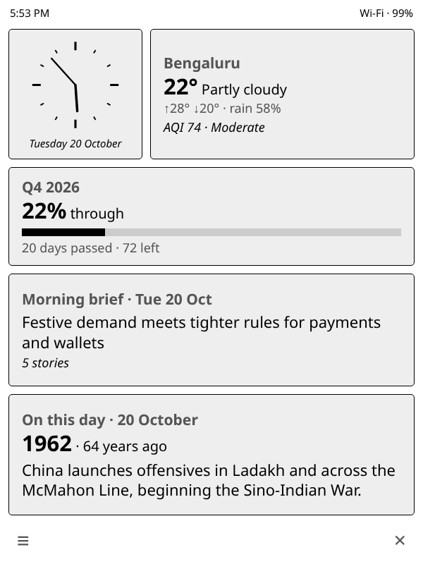<br><sub>Mock-up from the sample data. On the Kindle, Bookshelf sizes the cards to fit.</sub></p>

On the dashboard, long-press any card, tap **⊕** (add) and choose **Kindle Hub**, then pick a
screen or **What's on now**. Tap a card to open that screen full size; long-press →
**Module settings…** to change it. Cards update when Wi-Fi is already on. The cards show the
short summary each screen publishes (see `tile()` in [Build your own screen](#build-your-own-screen)).
The plugin keeps a two-line loader for them in `koreader/settings/bookshelf/micromodules/`; the
code is [`bookshelf_card.lua`](koreader/kindlehub.koplugin/bookshelf_card.lua).

</details>

---

## When something fails

Each part fails on its own, and the Kindle never ends up blank.

| If this fails | What you see |
|---|---|
| The Year of the Day picture (no Cloudflare keys, or an error) | The text version of the screen |
| The AI (no key, rate limit, bad answer) | The brief switches to **Headlines only**: the top stories from your feeds, no summary |
| A news feed | That feed is skipped; the others still go in |
| Weather or markets | That screen drops out of the rotation until the next run that works |
| A whole run | The Kindle keeps showing the last screen it downloaded |

<p align="center">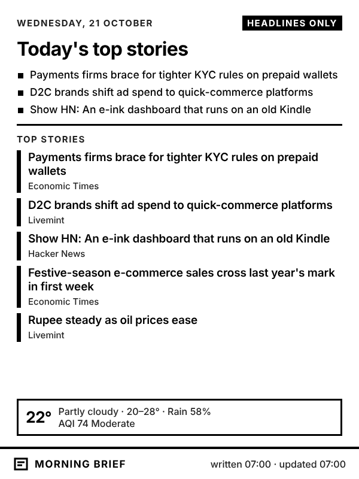<br><sub>The fallback brief</sub></p>

The AI can only pick from the stories it was given. Each story's title and link come from your
feeds, never from the model, so it can't invent a headline or a link.

---

## Make it yours

Everything you're likely to change is in [`config.yaml`](config.yaml):

| Setting | What it does |
|---|---|
| `location` | City name and coordinates for weather and air quality |
| `feeds` | The news sources the AI chooses from. Any RSS or Atom feed works |
| `ai.reader_profile` | What you care about. This goes straight into the AI's instructions |
| `ai.stories` | How many stories the brief picks |
| `ai.models` | `"auto-free"` picks from OpenRouter's current free models. Or list exact model IDs |
| `screen.width` / `height` | 600×800 for this Kindle. Change if you move to another model |
| `screen.refresh_seconds` | How often the Kindle asks for a new screen |

- **When each screen shows:** the `show:` times in each screen's `plugins/<name>/plugin.yaml`.
  Add `days: [mon, tue, wed, thu, fri]` to limit a screen to some days, and
  `only_in_window: true` to keep it off the Kindle outside its times (markets does both).
- **How often the brief is rewritten:** `refresh_hours` in `plugins/morning_brief/plugin.yaml`
  (default 3; 0 for once a day). Before `quiet_until` (06:00) it's never rewritten.
- **Clock style:** `clock: "12h"` (7:05 PM) or `"24h"` (19:05) in `config.yaml`.
- **Year of the Day style:** in `plugins/year_of_the_day/plugin.yaml`, set `mode:` to `comic`
  (default), `newspaper` or `text`. Add words to `prefer:` (e.g. `["India"]`) to favour those events.
  Picture modes skip events built around a death or an attack, and never put real people's faces
  front and centre. `editions:` sets when a new year comes (default `["00:00", "12:00", "18:00"]`).
- **Financial-year quarters:** in `plugins/quarter_progress/plugin.yaml`, set
  `fiscal_year_start: 4`. October–December then shows as **Q3 FY27**.
- **When the builds run:** `.github/workflows/build.yml`. Cron times are UTC (IST = UTC + 5:30).

## Build your own screen

A screen is one folder under `plugins/` with three files. This countdown is a complete example.

<p align="center"><br><sub>What it renders</sub></p>

**`plugins/countdown/plugin.yaml`**: its name and when it's shown

```yaml
name: countdown
title: Countdown
order: 50
show:
  - "21:00-22:00"
```

**`plugins/countdown/fetch.py`**: gets the data

```python
from datetime import date


def fetch(ctx):
    target = date(2026, 12, 25)
    days = (target - ctx.now.date()).days
    if days < 0:
        return {"available": False}   # date passed: drop out of the rotation
    return {"event": "Holiday", "days": days, "when": target.strftime("%A, %d %B")}
```

**`plugins/countdown/template.liquid`**: lays it out

```liquid
<div class="layout" style="justify-content:center;align-items:center;text-align:center">
  <span class="label">{{ event }}</span>
  <span class="value value--xxlarge">{{ days }}</span>
  <span class="title">days to go</span>
  <span class="description">{{ when }}</span>
</div>
<div class="title_bar">
  {{ meta.glyph }}<span class="title">{{ meta.title }}</span>
  <span class="instance">updated {{ meta.updated }}</span>
</div>
```

How the pieces fit:

- **`fetch(ctx)`** returns a dictionary. Its keys become template variables. Return
  `{"available": False}` to skip the screen for this run.
- **Settings:** anything under `settings:` in a screen's `plugin.yaml` is available as `ctx.settings`.
- **A Bookshelf card (optional):** add `def tile(data)` to `fetch.py` and the screen gets a card
  on Bookshelf's dashboard. Return any of `heading`, `value`, `suffix`, `sub`, `context` and
  `text` (short strings) and `bar` (0 to 1), for example
  `{"heading": data["event"], "value": str(data["days"]), "suffix": "days to go"}`.
- **Fetching data:** `ctx.get_json(url, params=...)` (with retries), `ctx.cfg` for `config.yaml`,
  `ctx.now` for the time in IST, and `ctx.usable("weather_aqi")` for another screen's data.
  Screens run in `order`, lowest first.
- **Templates** use [Liquid](https://shopify.github.io/liquid/). Every template also gets
  `meta.title`, `meta.updated`, `meta.date_short`, `meta.date_long` and `meta.glyph`.
- **Styles** live in [`templates/screen.css`](templates/screen.css). The class names follow TRMNL's
  framework (`layout`, `title_bar`, `item`, `title`, `value`, `label`, `description`), so a
  template can move to TRMNL or a self-hosted LaraPaper server with light changes.
- **Long lists:** put `data-fit` on the list and `data-fit-item` on each entry. Entries that
  don't fit are dropped whole instead of being cut off mid-line.
- **Design for 600×800 e-ink:** big type, thick lines, black on white. Fine detail turns to mush
  on this screen.

Preview locally with `python build.py --demo --at 21:30 --only countdown`, then open
`site/screens/countdown.png`.

## Run it on your computer

```bash
pip install -r requirements.txt
python -m playwright install chromium

python build.py --demo              # sample data: no internet or key needed
python build.py --demo --at 14:30   # which screen is on at 14:30?
python build.py                     # real data (set OPENROUTER_API_KEY for the AI brief)
```

Open `site/index.html` to see the result. After changing a template, run
`python tools/docs_images.py` to refresh the pictures in this README.

## Good to know

- **Everything published is public.** That's fine for weather, news and markets. Don't add
  screens with private data (calendar, email, business numbers) to this repo. Those need
  private hosting.
- **Market data** comes from Yahoo Finance's unofficial chart API. If Yahoo blocks it, the
  markets screen drops out until it's switched to another source.
- **Free AI models come and go.** `auto-free` picks from OpenRouter's current free list on each
  run and tries up to three. On the free tier you get 50 requests a day; this uses about 10
  (7 briefs and 3 Year of the Day picture prompts).
- **The brief ebook is the morning edition.** KOReader's News Downloader doesn't download a
  day's brief again once it has it. The 3-hourly rewrites show up on the dashboard and on the
  web page (`/briefs/<date>.html`).
- **GitHub pauses schedules** in public repos after 60 days without commits. You'll get an email.
  Re-enable from the Actions tab, or push any small change.

## Project layout

```
build.py                  entry point: fetch → render → publish
config.yaml               your settings
plugins/<screen>/         one folder per screen (plugin.yaml, fetch.py, template.liquid)
core/                     shared code: OpenRouter client, feed writer, renderer, playlist
templates/screen.css      e-ink styles shared by all screens
koreader/                 Kindle side: Kindle Hub plugin (+ Bookshelf card), KUAL button, feed entry
fixtures/demo/            sample data for --demo
tools/docs_images.py      regenerates the README images (tools/bookshelf_mockup.py: the card mock-up)
tools/make_clock_font.py  cuts the font the Kindle draws the weather clock with
assets/fonts/             Inter typeface (SIL Open Font License, included)
.github/workflows/        schedule and GitHub Pages deploy
```

## Credits

[KOReader](https://github.com/koreader/koreader) ·
[TRMNL KOReader plugin](https://github.com/usetrmnl/trmnl-koreader) and the
[TRMNL framework](https://trmnl.com/framework) this borrows its class names from ·
[Open-Meteo](https://open-meteo.com) for weather and air quality ·
[OpenRouter](https://openrouter.ai) for the AI models ·
[Cloudflare Workers AI](https://developers.cloudflare.com/workers-ai/) running FLUX.1 [schnell] for the illustrations ·
[Wikipedia](https://www.wikipedia.org) for On this day ·
[Inter](https://rsms.me/inter/) by Rasmus Andersson.
